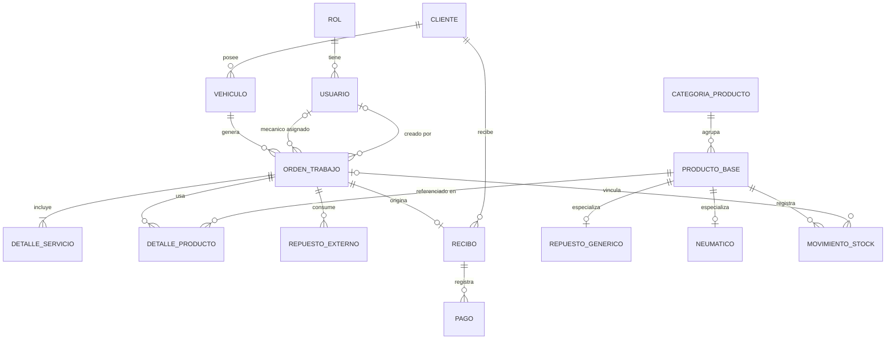

# 🗄️ Base de Datos Completa — Taller Mecánico

> **Motor:** SQLite3 (desarrollo) / PostgreSQL (producción recomendada)  
> **ORM:** Django 4.x  
> **Última actualización:** Octubre 2026  
> **Total de modelos:** 16 (15 tablas físicas de negocio + 1 clase abstracta `ModeloBase`)  
> **Módulo de Auditoría:** Eliminado completamente

---

## 📐 Diagrama Entidad-Relación (ERD)



---

## 📦 MÓDULO: CORE

### 1. `core_modelobase` *(Abstracta — no crea tabla)*

Clase base abstracta de la que heredan los modelos principales del sistema. Sus campos se **incorporan directamente** en cada tabla hija.

| Campo | Tipo SQL | Restricciones | Descripción |
|---|---|---|---|
| `fecha_creacion` | `DATETIME` | NOT NULL | Timestamp automático al crear (`auto_now_add=True`) |
| `fecha_modificacion` | `DATETIME` | NOT NULL | Timestamp automático al actualizar (`auto_now=True`) |

> ⚙️ Usada por: `Cliente`, `Vehiculo`, `ProductoBase`, `CategoriaProducto`, `OrdenTrabajo`, `Recibo`

---

## 👥 MÓDULO: ACCOUNTS (Usuarios y Roles)

### 2. `accounts_rol`

Control granular de privilegios y accesos por módulo y acción del sistema.

| Campo | Tipo SQL | Restricciones | Descripción |
|---|---|---|---|
| `id` | `INTEGER` | PK, Auto | Clave primaria |
| `nombre` | `VARCHAR(50)` | NOT NULL, UNIQUE | Nombre descriptivo del rol |
| `codigo` | `VARCHAR(30)` | NOT NULL, UNIQUE | Código identificador (ej: `DUENO`, `ADMINISTRADOR`) |
| `descripcion` | `TEXT` | — | Descripción y alcance del rol |
| **— Panel de Control —** | | | |
| `puede_ver_dashboard` | `BOOLEAN` | NOT NULL, DEFAULT TRUE | Acceso al panel de estadísticas y accesos directos |
| **— Clientes —** | | | |
| `puede_ver_clientes` | `BOOLEAN` | NOT NULL, DEFAULT TRUE | Ver listado y fichas de clientes |
| `puede_crear_clientes` | `BOOLEAN` | NOT NULL, DEFAULT FALSE | Dar de alta nuevos clientes |
| `puede_editar_clientes` | `BOOLEAN` | NOT NULL, DEFAULT FALSE | Editar información de clientes |
| `puede_eliminar_clientes` | `BOOLEAN` | NOT NULL, DEFAULT FALSE | Baja lógica (desactivar) de clientes |
| **— Vehículos —** | | | |
| `puede_ver_vehiculos` | `BOOLEAN` | NOT NULL, DEFAULT TRUE | Ver listado de vehículos |
| `puede_crear_vehiculos` | `BOOLEAN` | NOT NULL, DEFAULT FALSE | Registrar nuevos vehículos |
| `puede_editar_vehiculos` | `BOOLEAN` | NOT NULL, DEFAULT FALSE | Modificar fichas vehiculares |
| `puede_eliminar_vehiculos` | `BOOLEAN` | NOT NULL, DEFAULT FALSE | Baja lógica de vehículos |
| **— Órdenes de Trabajo —** | | | |
| `puede_ver_ordenes` | `BOOLEAN` | NOT NULL, DEFAULT TRUE | Ver tablero y lista de órdenes |
| `puede_crear_ordenes` | `BOOLEAN` | NOT NULL, DEFAULT FALSE | Abrir nuevas órdenes de trabajo |
| `puede_editar_ordenes` | `BOOLEAN` | NOT NULL, DEFAULT FALSE | Modificar diagnóstico y detalles |
| `puede_cambiar_estado_ordenes` | `BOOLEAN` | NOT NULL, DEFAULT FALSE | Avanzar o retroceder estados de OT |
| `puede_eliminar_ordenes` | `BOOLEAN` | NOT NULL, DEFAULT FALSE | Cancelar/eliminar órdenes |
| **— Inventario & Repuestos —** | | | |
| `puede_ver_inventario` | `BOOLEAN` | NOT NULL, DEFAULT TRUE | Ver catálogo y stock de repuestos y neumáticos |
| `puede_crear_inventario` | `BOOLEAN` | NOT NULL, DEFAULT FALSE | Crear nuevos productos |
| `puede_editar_inventario` | `BOOLEAN` | NOT NULL, DEFAULT FALSE | Modificar precios, nombres o especificaciones |
| `puede_eliminar_inventario` | `BOOLEAN` | NOT NULL, DEFAULT FALSE | Baja lógica de artículos |
| `puede_ajustar_stock` | `BOOLEAN` | NOT NULL, DEFAULT FALSE | Registrar compras/entradas y ajustes manuales |
| **— Recibos & Cobros —** | | | |
| `puede_ver_comprobantes` | `BOOLEAN` | NOT NULL, DEFAULT FALSE | Ver comprobantes emitidos |
| `puede_crear_comprobantes` | `BOOLEAN` | NOT NULL, DEFAULT FALSE | Generar recibos para órdenes finalizadas |
| `puede_cobrar_comprobantes` | `BOOLEAN` | NOT NULL, DEFAULT FALSE | Registrar cobranzas y pagos en efectivo |
| `puede_anular_comprobantes` | `BOOLEAN` | NOT NULL, DEFAULT FALSE | Anular comprobantes |
| **— Reportes & Analítica —** | | | |
| `puede_ver_reportes` | `BOOLEAN` | NOT NULL, DEFAULT FALSE | Acceder a reportes comerciales y gráficos |
| `puede_ver_cierre_diario` | `BOOLEAN` | NOT NULL, DEFAULT FALSE | Acceder a la auditoría de caja / cierre del día |
| **— Gestión y Seguridad —** | | | |
| `puede_gestionar_usuarios` | `BOOLEAN` | NOT NULL, DEFAULT FALSE | Crear, editar y resetear usuarios |
| `puede_gestionar_roles` | `BOOLEAN` | NOT NULL, DEFAULT FALSE | Configurar roles y matriz de privilegios |
| `fecha_creacion` | `DATETIME` | NOT NULL | Timestamp de creación |
| `fecha_modificacion` | `DATETIME` | NOT NULL | Timestamp de modificación |

**Roles precargados por defecto:**

| Código | Nombre | Alcance |
|---|---|---|
| `DUENO` | Dueño / Gerencia General | Acceso absoluto a todos los módulos y opciones |
| `ADMINISTRADOR` | Administrador del Taller | Gestión operativa, comercial, de personal y taller |
| `MECANICO` | Mecánico / Operario | Tablero de órdenes y actualización de estados |
| `RECEPCIONISTA` | Recepción y Asesoría | Clientes, vehículos, apertura de órdenes y cobros |

---

### 3. `accounts_usuario`

Extiende `AbstractBaseUser` y `PermissionsMixin` de Django. Representa al usuario del sistema.

| Campo | Tipo SQL | Restricciones | Descripción |
|---|---|---|---|
| `id` | `INTEGER` | PK, Auto | Clave primaria |
| `password` | `VARCHAR(128)` | NOT NULL | Hash criptográfico de contraseña (PBKDF2) |
| `last_login` | `DATETIME` | NULL | Timestamp del último inicio de sesión |
| `is_superuser` | `BOOLEAN` | NOT NULL | Bandera de superusuario Django |
| `username` | `VARCHAR(50)` | NOT NULL, UNIQUE | Nombre de usuario único para login |
| `email` | `VARCHAR(254)` | NOT NULL, UNIQUE | Correo electrónico |
| `nombre_completo` | `VARCHAR(150)` | NOT NULL | Nombre y apellido del trabajador |
| `rol_id` | `INTEGER` | FK → `accounts_rol`, NULL | Rol asignado |
| `telefono` | `VARCHAR(20)` | — | Teléfono de contacto |
| `foto` | `VARCHAR(100)` | NULL | Ruta a imagen de perfil |
| `is_active` | `BOOLEAN` | NOT NULL, DEFAULT TRUE | Cuenta activa / inactiva |
| `is_staff` | `BOOLEAN` | NOT NULL, DEFAULT FALSE | Permiso de acceso a panel administrativo |
| `date_joined` | `DATETIME` | NOT NULL | Fecha de alta en el sistema |
| `ultimo_acceso` | `DATETIME` | NULL | Último registro de actividad |

**Índices:** `username` (UNIQUE), `email` (UNIQUE), `rol_id`  
**Comportamiento FK:** `rol_id` → `SET NULL` al eliminar el rol.

**Usuarios iniciales precargados:**

| Username | Nombre | Rol Asignado | Superuser |
|---|---|---|---|
| `admin` | Administrador Principal | `DUENO` | ✅ |
| `supervisor` | Carlos Supervilla | `ADMINISTRADOR` | ❌ |
| `recepcionista` | María González | `RECEPCIONISTA` | ❌ |
| `mecanico1` | Juan Rodríguez | `MECANICO` | ❌ |
| `mecanico2` | Pedro Ramírez | `MECANICO` | ❌ |

---

## 🧑‍💼 MÓDULO: CLIENTES

### 4. `clientes_cliente`

Hereda de `ModeloBase`. Representa clientes particulares o empresas.

| Campo | Tipo SQL | Restricciones | Descripción |
|---|---|---|---|
| `id` | `INTEGER` | PK, Auto | Clave primaria |
| `nombre_razon_social` | `VARCHAR(100)` | NOT NULL | Nombre completo o Razón Social |
| `documento` | `VARCHAR(20)` | NOT NULL, UNIQUE | DNI, CUIT o CI único |
| `telefono` | `VARCHAR(20)` | NOT NULL, DEFAULT '' | Teléfono principal / WhatsApp |
| `email` | `VARCHAR(254)` | NOT NULL, DEFAULT '' | Correo para notificaciones |
| `direccion` | `TEXT` | NOT NULL, DEFAULT '' | Dirección física |
| `foto` | `VARCHAR(100)` | NULL | Foto del cliente o logotipo |
| `activo` | `BOOLEAN` | NOT NULL, DEFAULT TRUE | Borrado lógico (soft delete) |
| `fecha_creacion` | `DATETIME` | NOT NULL | Timestamp de alta |
| `fecha_modificacion` | `DATETIME` | NOT NULL | Timestamp de edición |

**Índices:** `documento` (UNIQUE), `nombre_razon_social`

---

## 🚗 MÓDULO: VEHÍCULOS

### 5. `vehiculos_vehiculo`

Hereda de `ModeloBase`. Vehículos registrados en el taller asociados a un cliente.

| Campo | Tipo SQL | Restricciones | Descripción |
|---|---|---|---|
| `id` | `INTEGER` | PK, Auto | Clave primaria |
| `cliente_id` | `INTEGER` | FK → `clientes_cliente`, NOT NULL | Propietario del vehículo |
| `placa` | `VARCHAR(10)` | NOT NULL, UNIQUE | Matrícula / Patente única |
| `marca` | `VARCHAR(30)` | NOT NULL | Marca (Toyota, Ford, etc.) |
| `modelo` | `VARCHAR(50)` | NOT NULL | Modelo (Corolla, Ranger, etc.) |
| `anio` | `INTEGER` | NULL | Año de fabricación |
| `vin` | `VARCHAR(50)` | UNIQUE, NULL | N° de chasis / VIN (opcional) |
| `color` | `VARCHAR(20)` | NOT NULL, DEFAULT 'BLANCO' | Color con validación de choices |
| `kilometraje_actual` | `INTEGER` | NOT NULL, DEFAULT 0 | Kilometraje acumulado reportado |
| `foto` | `VARCHAR(100)` | NULL | Foto del vehículo |
| `activo` | `BOOLEAN` | NOT NULL, DEFAULT TRUE | Borrado lógico |
| `fecha_creacion` | `DATETIME` | NOT NULL | Timestamp de alta |
| `fecha_modificacion` | `DATETIME` | NOT NULL | Timestamp de edición |

**Restricción CHECK:** `color IN ('BLANCO','NEGRO','GRIS','PLATA','ROJO','AZUL','VERDE','AMARILLO','NARANJA','MARRON','OTRO')`  
**Comportamiento FK:** `cliente_id` → `RESTRICT` (impide borrar clientes con vehículos activos).  
**Índices:** `placa` (UNIQUE), `cliente_id`

---

## 📦 MÓDULO: INVENTARIO

### 6. `inventario_categoriaproducto`

Hereda de `ModeloBase`. Clasificación jerárquica de repuestos y neumáticos.

| Campo | Tipo SQL | Restricciones | Descripción |
|---|---|---|---|
| `id` | `INTEGER` | PK, Auto | Clave primaria |
| `nombre` | `VARCHAR(50)` | NOT NULL, UNIQUE | Nombre de la categoría (Filtros, Frenos, etc.) |
| `codigo_prefijo` | `VARCHAR(10)` | NOT NULL, DEFAULT 'GEN' | Prefijo para SKU (FIL, FRE, NEU, etc.) |
| `tipo` | `VARCHAR(20)` | NOT NULL, DEFAULT 'REPUESTO' | `REPUESTO` o `NEUMATICO` |
| `descripcion` | `TEXT` | NOT NULL, DEFAULT '' | Detalle de la categoría |
| `icono` | `VARCHAR(50)` | NOT NULL, DEFAULT 'box' | Identificador del icono Material Symbols |
| `fecha_creacion` | `DATETIME` | NOT NULL | Timestamp de alta |
| `fecha_modificacion` | `DATETIME` | NOT NULL | Timestamp de edición |

**Restricción CHECK:** `tipo IN ('REPUESTO', 'NEUMATICO')`

---

### 7. `inventario_productobase`

Hereda de `ModeloBase`. Tabla padre polimórfica para todos los artículos del inventario.

| Campo | Tipo SQL | Restricciones | Descripción |
|---|---|---|---|
| `id` | `INTEGER` | PK, Auto | Clave primaria |
| `categoria_id` | `INTEGER` | FK → `inventario_categoriaproducto`, NOT NULL | Categoría del producto |
| `codigo_sku` | `VARCHAR(50)` | NOT NULL, UNIQUE | Código SKU autogenerado |
| `nombre` | `VARCHAR(150)` | NOT NULL | Nombre comercial |
| `descripcion` | `TEXT` | NOT NULL, DEFAULT '' | Especificaciones técnicas |
| `precio_costo` | `DECIMAL(12,2)` | NOT NULL, >= 0 | Costo de adquisición unitario |
| `precio_venta` | `DECIMAL(12,2)` | NOT NULL, >= 0 | Precio final de venta al público |
| `stock_actual` | `INTEGER` | NOT NULL, DEFAULT 0, >= 0 | Cantidad física en depósito |
| `stock_minimo` | `INTEGER` | NOT NULL, DEFAULT 5, >= 0 | Umbral de alerta de reposición |
| `tipo_producto` | `VARCHAR(20)` | NOT NULL | `REPUESTO` o `NEUMATICO` |
| `imagen` | `VARCHAR(100)` | NULL | Foto del artículo |
| `activo` | `BOOLEAN` | NOT NULL, DEFAULT TRUE | Borrado lógico |
| `fecha_creacion` | `DATETIME` | NOT NULL | Timestamp de alta |
| `fecha_modificacion` | `DATETIME` | NOT NULL | Timestamp de edición |

**Comportamiento FK:** `categoria_id` → `RESTRICT`  
**Índices:** `codigo_sku` (UNIQUE), `tipo_producto`, `categoria_id`

---

### 8. `inventario_repuestogenerico`

Extensión 1-a-1 de `ProductoBase` para repuestos mecánicos convencionales.

| Campo | Tipo SQL | Restricciones | Descripción |
|---|---|---|---|
| `producto_id` | `INTEGER` | PK, FK → `inventario_productobase` | ID compartido con ProductoBase |
| `marca_repuesto` | `VARCHAR(50)` | NOT NULL, DEFAULT '' | Marca del fabricante (Bosch, Fram, etc.) |
| `numero_parte` | `VARCHAR(100)` | NOT NULL, DEFAULT '' | Número de parte original |
| `compatible_con` | `TEXT` | NOT NULL, DEFAULT '' | Modelos compatibles |

**Comportamiento FK:** `producto_id` → `CASCADE`

---

### 9. `inventario_neumatico`

Extensión 1-a-1 de `ProductoBase` para neumáticos (gomería).

| Campo | Tipo SQL | Restricciones | Descripción |
|---|---|---|---|
| `producto_id` | `INTEGER` | PK, FK → `inventario_productobase` | ID compartido con ProductoBase |
| `marca_neumatico` | `VARCHAR(50)` | NOT NULL | Marca (Michelin, Pirelli, etc.) |
| `modelo_neumatico` | `VARCHAR(50)` | NOT NULL, DEFAULT '' | Línea/modelo del neumático |
| `ancho` | `INTEGER` | NOT NULL | Ancho en mm (ej: 205) |
| `perfil` | `INTEGER` | NOT NULL | Relación de aspecto en % (ej: 55) |
| `diametro` | `INTEGER` | NOT NULL | Diámetro de llanta en pulgadas (ej: 16) |
| `indice_carga` | `VARCHAR(10)` | NOT NULL, DEFAULT '' | Índice de carga (ej: 91) |
| `indice_velocidad` | `VARCHAR(5)` | NOT NULL, DEFAULT '' | Código de velocidad (ej: V, H, T) |
| `tipo` | `VARCHAR(20)` | NOT NULL, DEFAULT 'ALL_SEASON' | Estación o terreno |
| `estado` | `VARCHAR(10)` | NOT NULL, DEFAULT 'NUEVO' | `NUEVO` o `USADO` |
| `profundidad_restante` | `DECIMAL(4,1)` | NULL | Medición de banda de rodamiento en mm |

**Restricciones CHECK:**  
- `tipo IN ('VERANO','INVIERNO','ALL_SEASON','OFF_ROAD')`  
- `estado IN ('NUEVO','USADO')`  
**Comportamiento FK:** `producto_id` → `CASCADE`

---

### 10. `inventario_movimientostock`

Kardex / bitácora auditable de entradas, salidas y ajustes de inventario.

| Campo | Tipo SQL | Restricciones | Descripción |
|---|---|---|---|
| `id` | `INTEGER` | PK, Auto | Clave primaria |
| `producto_id` | `INTEGER` | FK → `inventario_productobase`, NOT NULL | Producto afectado |
| `tipo_movimiento` | `VARCHAR(20)` | NOT NULL | Tipo de movimiento |
| `cantidad` | `INTEGER` | NOT NULL | Variación numérica (+ entrada, - salida) |
| `stock_resultante` | `INTEGER` | NOT NULL | Saldo de stock tras el movimiento |
| `motivo` | `VARCHAR(200)` | NOT NULL | Justificación del movimiento |
| `orden_id` | `INTEGER` | FK → `ordenes_ordentrabajo`, NULL | Orden vinculada (si fue por consumo) |
| `usuario` | `VARCHAR(150)` | NOT NULL, DEFAULT '' | Nombre de usuario que ejecutó el cambio |
| `precio_unitario` | `DECIMAL(12,2)` | NULL | Precio de costo o venta al momento |
| `fecha_movimiento` | `DATETIME` | NOT NULL | Timestamp del movimiento |

**Restricción CHECK:** `tipo_movimiento IN ('ENTRADA','SALIDA','AJUSTE','VENTA_DIRECTA')`  
**Comportamiento FK:** `producto_id` → `CASCADE`, `orden_id` → `SET NULL`  
**Índices:** `producto_id`, `fecha_movimiento`

---

## 🔧 MÓDULO: ÓRDENES DE TRABAJO

### 11. `ordenes_ordentrabajo`

Hereda de `ModeloBase`. Núcleo de la operación técnica del taller.

| Campo | Tipo SQL | Restricciones | Descripción |
|---|---|---|---|
| `id` | `INTEGER` | PK, Auto | Clave primaria |
| `numero_orden` | `VARCHAR(20)` | NOT NULL, UNIQUE | Código correlativo `YYYYMM####` |
| `vehiculo_id` | `INTEGER` | FK → `vehiculos_vehiculo`, NOT NULL | Vehículo atendido |
| `mecanico_id` | `INTEGER` | FK → `accounts_usuario`, NULL | Mecánico asignado |
| `creado_por_id` | `INTEGER` | FK → `accounts_usuario`, NULL | Asesor / usuario que abrió la orden |
| `estado` | `VARCHAR(20)` | NOT NULL, DEFAULT 'PENDIENTE' | Estado del flujo |
| `kilometraje` | `INTEGER` | NOT NULL, DEFAULT 0 | Odómetro al ingreso |
| `diagnostico` | `TEXT` | NOT NULL, DEFAULT '' | Falla reportada y evaluación |
| `observaciones` | `TEXT` | NOT NULL, DEFAULT '' | Notas del mecánico o cliente |
| `fecha_prometida` | `DATETIME` | NULL | Compromiso estimado de entrega |
| `fecha_cierre` | `DATETIME` | NULL | Fecha y hora real de finalización |
| `fecha_creacion` | `DATETIME` | NOT NULL | Timestamp de alta |
| `fecha_modificacion` | `DATETIME` | NOT NULL | Timestamp de edición |

**Restricción CHECK:** `estado IN ('PENDIENTE','EN_PROCESO','PAUSADA','COMPLETADA','COBRADA','CANCELADA')`  
**Comportamiento FK:** `vehiculo_id` → `RESTRICT`, `mecanico_id` → `SET NULL`, `creado_por_id` → `SET NULL`  
**Índices:** `numero_orden` (UNIQUE), `estado`, `vehiculo_id`, `mecanico_id`

---

### 12. `ordenes_detalleservicio`

Líneas de mano de obra y servicios realizados en una orden.

| Campo | Tipo SQL | Restricciones | Descripción |
|---|---|---|---|
| `id` | `INTEGER` | PK, Auto | Clave primaria |
| `orden_id` | `INTEGER` | FK → `ordenes_ordentrabajo`, NOT NULL | Orden contenedora |
| `descripcion` | `VARCHAR(200)` | NOT NULL | Descripción del servicio/tarea |
| `cantidad` | `DECIMAL(8,2)` | NOT NULL, DEFAULT 1.00, >= 0 | Horas o cantidad de servicios |
| `precio_unitario` | `DECIMAL(12,2)` | NOT NULL, DEFAULT 0.00, >= 0 | Tarifa por hora o unidad |

**Comportamiento FK:** `orden_id` → `CASCADE`  
**Índices:** `orden_id`

---

### 13. `ordenes_detalleproducto`

Consumos de repuestos o neumáticos tomados del inventario del taller.

| Campo | Tipo SQL | Restricciones | Descripción |
|---|---|---|---|
| `id` | `INTEGER` | PK, Auto | Clave primaria |
| `orden_id` | `INTEGER` | FK → `ordenes_ordentrabajo`, NOT NULL | Orden contenedora |
| `producto_id` | `INTEGER` | FK → `inventario_productobase`, NOT NULL | Producto utilizado |
| `cantidad` | `INTEGER` | NOT NULL, DEFAULT 1, >= 1 | Unidades consumidas |
| `precio_unitario` | `DECIMAL(12,2)` | NOT NULL, DEFAULT 0.00 | Precio de venta cobrado |

**Comportamiento FK:** `orden_id` → `CASCADE`, `producto_id` → `RESTRICT`  
**Índices:** `orden_id`, `producto_id`

---

### 14. `ordenes_repuestoexterno`

Repuestos o insumos adquiridos de terceros exclusivamente para una orden específica.

| Campo | Tipo SQL | Restricciones | Descripción |
|---|---|---|---|
| `id` | `INTEGER` | PK, Auto | Clave primaria |
| `orden_id` | `INTEGER` | FK → `ordenes_ordentrabajo`, NOT NULL | Orden contenedora |
| `descripcion` | `VARCHAR(200)` | NOT NULL | Descripción del repuesto externo |
| `proveedor` | `VARCHAR(100)` | NOT NULL, DEFAULT '' | Comercio / proveedor donde se adquirió |
| `cantidad` | `INTEGER` | NOT NULL, DEFAULT 1, >= 1 | Unidades |
| `precio_unitario` | `DECIMAL(12,2)` | NOT NULL, DEFAULT 0.00, >= 0 | Precio cobrado al cliente |

**Comportamiento FK:** `orden_id` → `CASCADE`  
**Índices:** `orden_id`

---

## 🧾 MÓDULO: RECIBOS Y COBROS

### 15. `recibos_recibo`

Hereda de `ModeloBase`. Recibo oficial de servicio y cobro derivado de una orden completada.

| Campo | Tipo SQL | Restricciones | Descripción |
|---|---|---|---|
| `id` | `INTEGER` | PK, Auto | Clave primaria |
| `numero_recibo` | `VARCHAR(20)` | NOT NULL, UNIQUE | Número correlativo `RECYYYYMM####` |
| `orden_id` | `INTEGER` | FK → `ordenes_ordentrabajo`, UNIQUE | Relación 1 a 1 con la orden |
| `cliente_id` | `INTEGER` | FK → `clientes_cliente`, NOT NULL | Cliente asociado |
| `fecha_emision` | `DATETIME` | NOT NULL | Fecha y hora de expedición |
| `subtotal` | `DECIMAL(12,2)` | NOT NULL, DEFAULT 0.00 | Monto neto gravado |
| `iva_porcentaje` | `DECIMAL(5,2)` | NOT NULL, DEFAULT 21.00 | Tasa de impuesto IVA aplicada |
| `iva_monto` | `DECIMAL(12,2)` | NOT NULL, DEFAULT 0.00 | Monto liquidado de IVA |
| `total` | `DECIMAL(12,2)` | NOT NULL, DEFAULT 0.00 | Importe total final |
| `estado_pago` | `VARCHAR(20)` | NOT NULL, DEFAULT 'PENDIENTE' | Situación del cobro |
| `notas` | `TEXT` | NOT NULL, DEFAULT '' | Observaciones en el recibo |
| `fecha_creacion` | `DATETIME` | NOT NULL | Timestamp de alta |
| `fecha_modificacion` | `DATETIME` | NOT NULL | Timestamp de edición |

**Restricción CHECK:** `estado_pago IN ('PENDIENTE','PARCIAL','PAGADA','ANULADA')`  
**Comportamiento FK:** `orden_id` → `RESTRICT`, `cliente_id` → `RESTRICT`  
**Índices:** `numero_recibo` (UNIQUE), `cliente_id`, `estado_pago`

---

### 16. `recibos_pago`

Registro de cobros parciales o cancelaciones totales asociadas a un recibo.

| Campo | Tipo SQL | Restricciones | Descripción |
|---|---|---|---|
| `id` | `INTEGER` | PK, Auto | Clave primaria |
| `recibo_id` | `INTEGER` | FK → `recibos_recibo`, NOT NULL | Recibo que recibe el cobro |
| `monto` | `DECIMAL(12,2)` | NOT NULL, > 0 | Importe cobrado |
| `metodo_pago` | `VARCHAR(30)` | NOT NULL, DEFAULT 'EFECTIVO' | Canal de pago |
| `referencia` | `VARCHAR(100)` | NOT NULL, DEFAULT '' | Número de recibo manual o referencia |
| `fecha` | `DATETIME` | NOT NULL | Fecha y hora del cobro |
| `usuario` | `VARCHAR(150)` | NOT NULL, DEFAULT '' | Usuario que cobró |

**Restricción CHECK:** `metodo_pago IN ('EFECTIVO')`  
**Comportamiento FK:** `recibo_id` → `CASCADE`  
**Índices:** `recibo_id`

---

## 📊 Matriz Resumen de Tablas de la Base de Datos

| # | Nombre de Tabla | Aplicación | Clase Modelo | ¿Hereda `ModeloBase`? |
|---|---|---|---|:---:|
| — | *(abstracta)* | `core` | `ModeloBase` | Base |
| 1 | `accounts_rol` | `accounts` | `Rol` | ❌ |
| 2 | `accounts_usuario` | `accounts` | `Usuario` | ❌ |
| 3 | `clientes_cliente` | `clientes` | `Cliente` | ✅ |
| 4 | `vehiculos_vehiculo` | `vehiculos` | `Vehiculo` | ✅ |
| 5 | `inventario_categoriaproducto` | `inventario` | `CategoriaProducto` | ✅ |
| 6 | `inventario_productobase` | `inventario` | `ProductoBase` | ✅ |
| 7 | `inventario_repuestogenerico` | `inventario` | `RepuestoGenerico` | ❌ |
| 8 | `inventario_neumatico` | `inventario` | `Neumatico` | ❌ |
| 9 | `inventario_movimientostock` | `inventario` | `MovimientoStock` | ❌ |
| 10 | `ordenes_ordentrabajo` | `ordenes` | `OrdenTrabajo` | ✅ |
| 11 | `ordenes_detalleservicio` | `ordenes` | `DetalleServicio` | ❌ |
| 12 | `ordenes_detalleproducto` | `ordenes` | `DetalleProducto` | ❌ |
| 13 | `ordenes_repuestoexterno` | `ordenes` | `RepuestoExterno` | ❌ |
| 14 | `recibos_recibo` | `recibos` | `Recibo` | ✅ |
| 15 | `recibos_pago` | `recibos` | `Pago` | ❌ |

---

## 📌 Migraciones de Limpieza de Auditoría

Para sincronizar cualquier base de datos existente con esta estructura limpia (sin auditoría), se aplican las migraciones generadas:

```powershell
.\entorno\Scripts\python.exe manage.py migrate
```

* `core 0002_delete_auditoria`: Elimina físicamente la tabla `core_auditoria`.
* `accounts 0003_remove_rol_puede_ver_auditoria`: Remueve la columna `puede_ver_auditoria` de la tabla `accounts_rol`.
